# Stokas

[](https://github.com/Umeem26/stokas/actions/workflows/ci.yml)
[](LICENSE)
[](https://flutter.dev)

> **Uang dan barang, satu catatan.**
> *Money and goods, one record.*

Stokas is a point-of-sale and inventory app for a small Indonesian minimarket, built with Flutter and Supabase.
It is meant for the three people who run such a store day to day: the owner, the cashier and the warehouse staff, each with their own screens and database-enforced permissions.

## Features

| Area | Feature | Status |
|---|---|---|
| Access | Login for owner (email) and staff (username), session kept on device, deactivated accounts signed out | Done |
| Access | Three roles with role-specific navigation; side rail at >= 768 px, bottom tabs below | Done |
| Cashier | Cart with product search by name or code | Done |
| Cashier | USB barcode scanner input (keyboard-wedge, detected by keystroke timing) | Done |
| Cashier | Cash with quick-cash buttons, QRIS and bank transfer (exact amount, two-step confirm) | Done |
| Cashier | Atomic server-side checkout with idempotency key (safe retry after network failure) | Done |
| Cashier | 80 mm PDF receipt, transaction history (cashiers see only their own) | Done |
| Cashier | Keyboard-first PC layout (Enter / Esc) | Done |
| Stock | Batches per product, floor and expiry date; FEFO deduction; expired batches not sellable | Done |
| Stock | Expiry labels and low-stock badges (at or below minimum stock) | Done |
| Warehouse | Receive goods (multiple lines), new product with initial stock | Done |
| Warehouse | Stock count (opname), transfer between floors, write-off of expired batches | Done |
| Owner | Home: today's revenue vs. yesterday and a "Needs attention" list | Done |
| Owner | Product detail: selling price, cost price, batches; soft delete | Done |
| Owner | Staff accounts: create, reset password, activate/deactivate | Done |
| UI | Light and dark theme (follows system), product images in Supabase Storage | Done |
| — | Items in [Roadmap](#roadmap) | Planned |

## Screenshots

All screenshots use demo data (products `DEMO-01..29`, no real customers). Android: Pixel 9 emulator; PC: Chrome 1440×900.
The full set, with every state and dialog, is listed in [media/manifest.md](media/manifest.md).

**Launch**

| Splash | Launcher icon | Login |
|---|---|---|
| 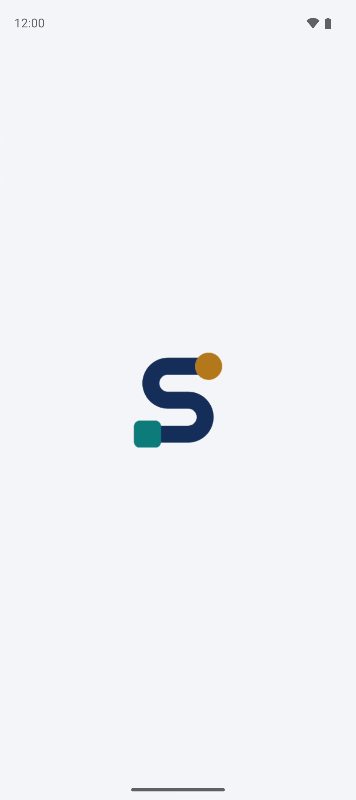 | 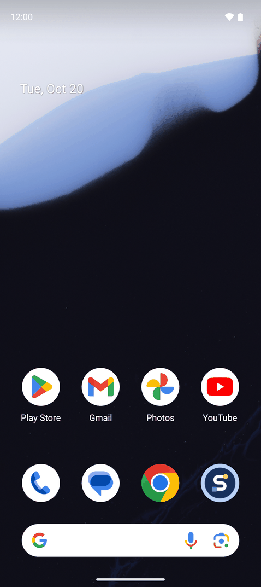 | 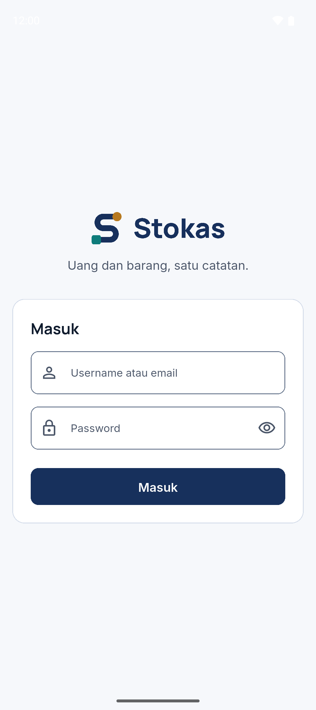 |
| Demo data | Demo data | Demo data |

**Owner**

| Home | Product detail | Staff |
|---|---|---|
| 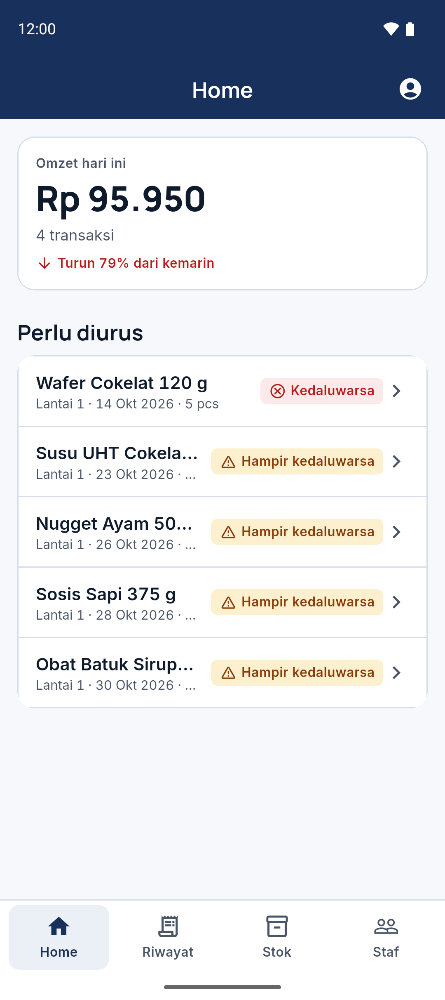 | 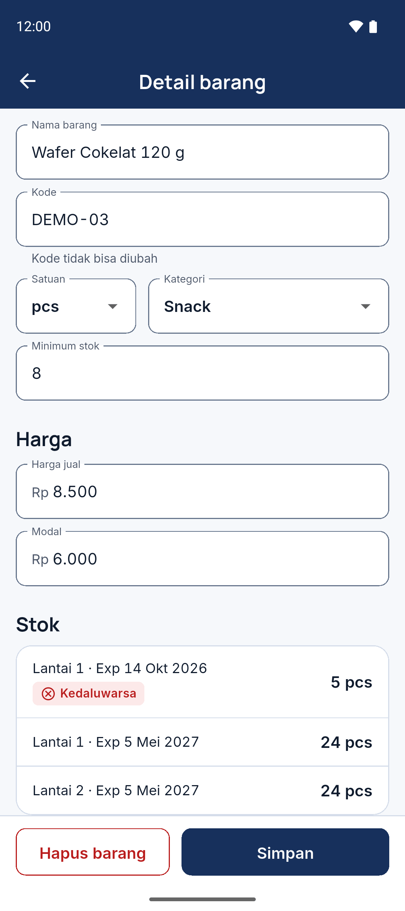 | 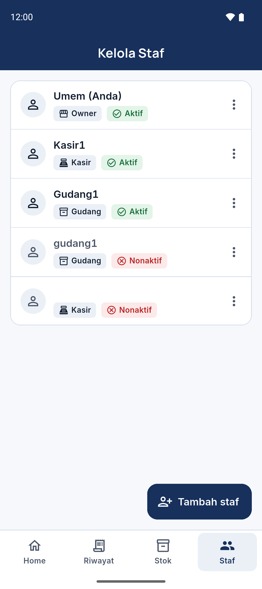 |
| Demo data | Demo data | Demo data |

**Cashier**

| Cart | Payment | Receipt |
|---|---|---|
| 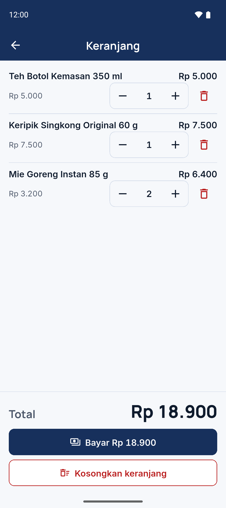 | 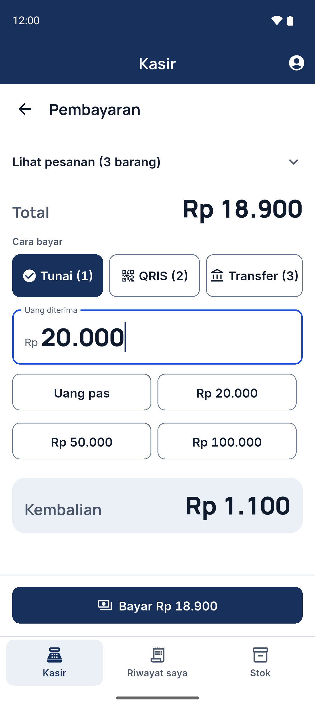 | 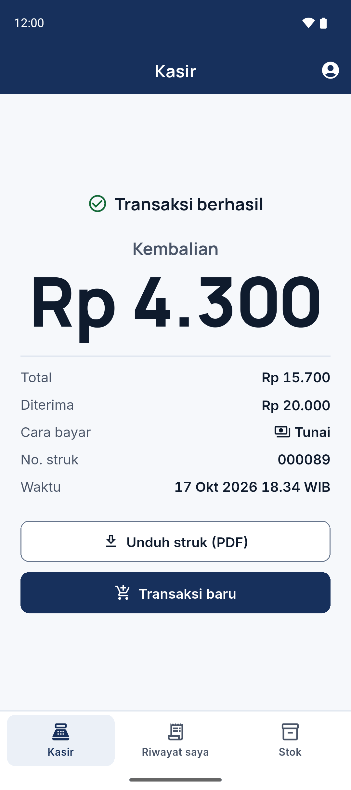 |
| Demo data | Demo data | Demo data |

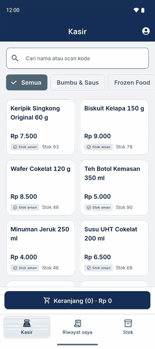<br>Checkout from search to receipt (demo data).

**Warehouse**

| Receive goods | Stock list |
|---|---|
| 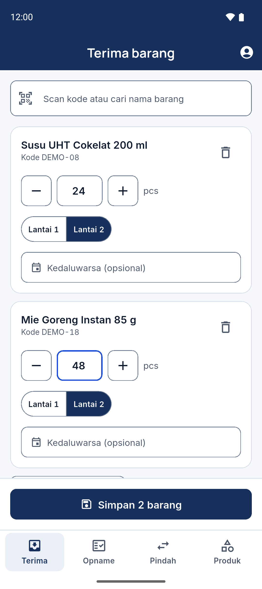 | 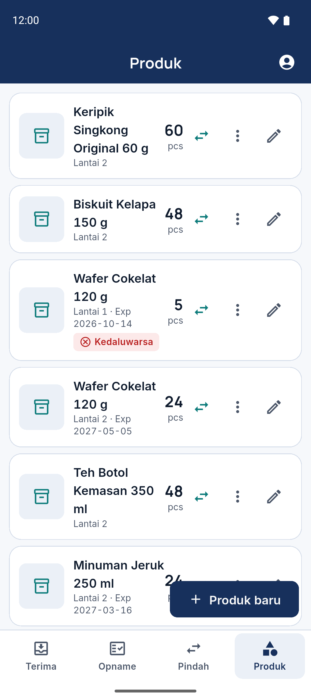 |
| Demo data | Demo data |

**PC**

| Cashier (keyboard-first) | Owner home |
|---|---|
| 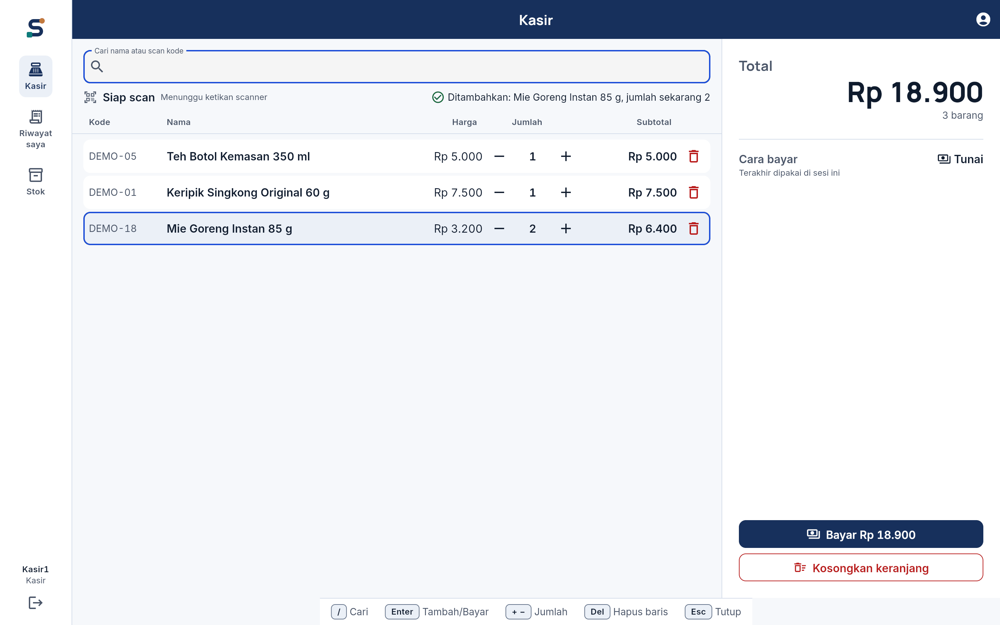 | 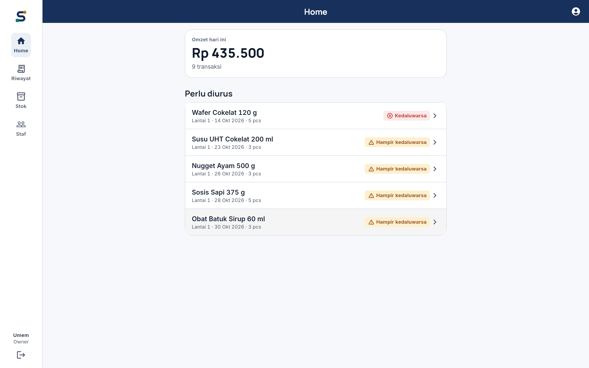 |
| Demo data | Demo data |

**Dark mode**

| Cart | Product detail | PC owner home |
|---|---|---|
| 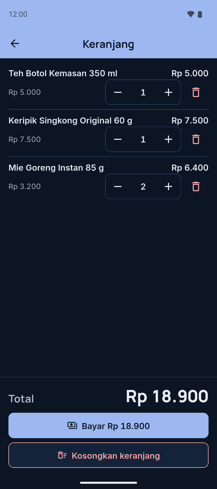 | 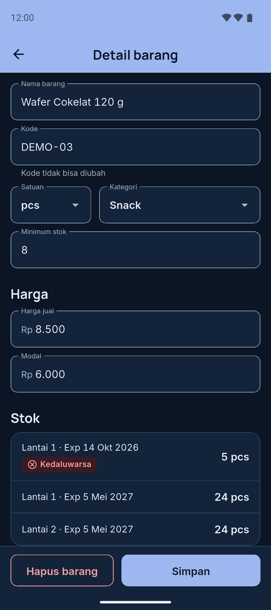 | 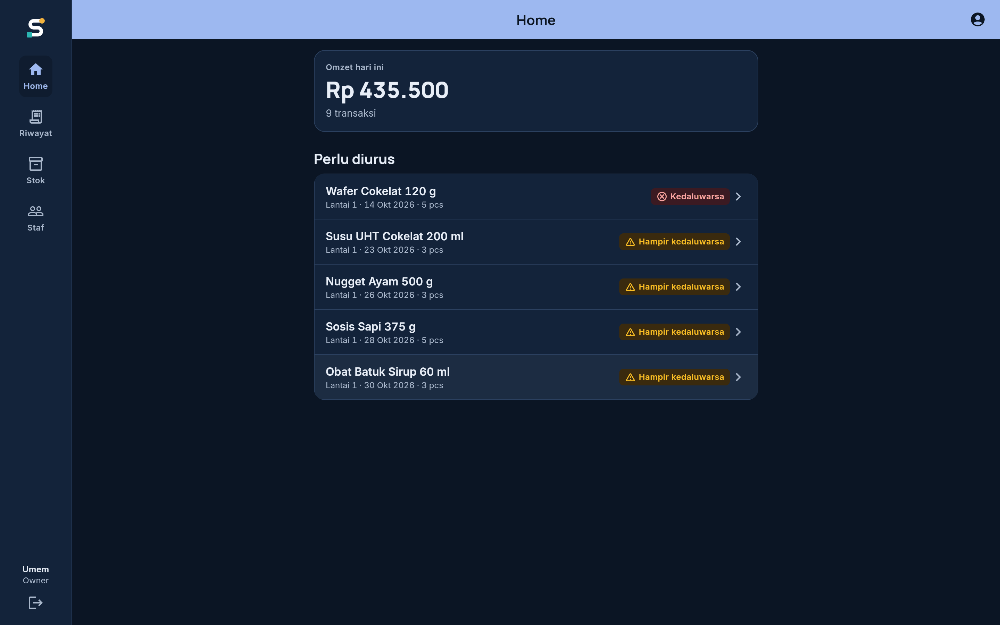 |
| Demo data | Demo data | Demo data |

## Roles and permissions

Taken from the RLS policies, triggers and RPC checks in [`supabase/migrations/`](supabase/migrations). The app hides menus with `can(role, Permission)` in [`lib/core/permissions.dart`](lib/core/permissions.dart); the database is the real gate.

| Capability | Owner | Cashier | Warehouse |
|---|:-:|:-:|:-:|
| Read products, categories, stock batches | ✅ | ✅ | ✅ |
| Checkout (`checkout` RPC) | ✅ | ✅ | — |
| Read transactions | All | Own only | — |
| Receive / count / transfer stock (`restock`, `stock_count`, `transfer_stock`) | ✅ | — | ✅ |
| Create product (only via `create_product_with_stock`; no direct `INSERT`) | ✅ | — | ✅ (price 0 only) |
| Edit product fields | ✅ | — | ✅ (not price) |
| Change price or delete product (soft) | ✅ | — | — |
| Read/write cost price (`product_costs`) | ✅ | — | — |
| Read stock ledger (`stock_movements`) | ✅ | — | ✅ |
| Upload product images | ✅ | — | ✅ |
| Manage staff (`staff-admin` Edge Function, `profiles` update) | ✅ | — | — |

## Architecture

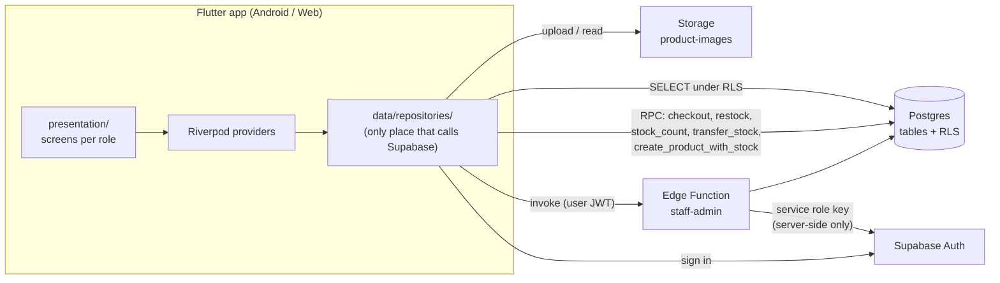

More detail (ERD, checkout sequence, role matrix): [docs/ARCHITECTURE.md](docs/ARCHITECTURE.md).

## Engineering decisions

1. **Atomic checkout with an idempotency key.** The `checkout` RPC recomputes the total from database prices, locks stock rows (`FOR UPDATE`), deducts stock and writes the transaction, its items and ledger rows in one database transaction. The client sends a UUID v4 key that stays the same on retry and changes when the cart changes or after success ([`checkout_controller.dart`](lib/data/checkout_controller.dart)); a unique `transactions.idempotency_key` makes a repeated call return the existing receipt instead of a second sale.
2. **Money is `bigint` Rupiah.** Migration 0004 converts every money column to `bigint`; the app uses `int` and formats only through `formatRupiah` ([`core/format.dart`](lib/core/format.dart)). Quantities stay `numeric` for items sold by weight.
3. **Prices are guarded in the database.** A `BEFORE UPDATE` trigger rejects price and `is_deleted` changes from non-owners, and cost price lives in a separate owner-only table (`product_costs`). New products can only be created through the `create_product_with_stock` RPC (`SECURITY DEFINER`), which inserts the product and its initial stock atomically and accepts a price above 0 only from the owner. Migration 0006 drops the `products_insert` policy and revokes `INSERT` on `products`, so warehouse staff have only `SELECT` and `UPDATE` there, with price and `is_deleted` guarded by the `products_guard_prices` trigger.
4. **Stock batches with FEFO and a ledger.** Stock is one row per (product, floor, expiry date). Checkout takes from the earliest-expiring batch first and skips expired ones (date in Asia/Jakarta). Every change writes a `stock_movements` row (`sale`, `restock`, `opname`, `transfer_in`, `transfer_out`). Direct `INSERT/UPDATE/DELETE` on stock and transaction tables is revoked; writes go through RPCs only.
5. **Staff admin runs server-side.** Creating staff, resetting passwords and (de)activating accounts needs the service role key, so it lives in the `staff-admin` Edge Function, which first checks that the caller is an active owner. The app itself refuses to start with a secret key ([`supabase_key_guard.dart`](lib/core/supabase_key_guard.dart)).

## Testing

| Suite | Count | Where | In CI |
|---|---|---|---|
| Flutter unit and widget tests (fake repositories) | 316 passing | `test/` (23 files) | Yes |
| End-to-end integration tests on an Android emulator against a Supabase project | 10 | `integration_test/app_test.dart` | No |
| Edge Function unit tests (`node:test`) | 4 | `supabase/functions/staff-admin/create_staff.test.ts` | No |

```bash
flutter analyze
flutter test
# Integration tests: copy integration_test/env.test.example.json to env.test.json and fill in test accounts
flutter test integration_test/app_test.dart -d emulator-5554 --dart-define-from-file=integration_test/env.test.json
# Edge Function
deno test supabase/functions/staff-admin/
```

## Getting started

1. Install Flutter (stable channel) and create a Supabase project.
2. Apply the SQL files in [`supabase/migrations/`](supabase/migrations) in order (0001 → 0006) on a fresh project, create the `product-images` storage bucket, and deploy `supabase/functions/staff-admin`.
3. Copy `.env.example` to `.env` and fill in `SUPABASE_URL` and `SUPABASE_ANON_KEY`.

> [!WARNING]
> `.env` is bundled into the app as an asset and can be downloaded by anyone on the web build.
> Use **only the publishable key** (`sb_publishable_...`). Secret keys (`sb_secret_...`) and `service_role` JWTs bypass RLS; the app rejects them at startup.

4. Run:

```bash
flutter pub get
# Web
flutter run -d chrome --web-port 8080
# Android emulator
flutter emulators --launch <emulator_id>
flutter run -d emulator-5554
```

## Roadmap

| Item | Status |
|---|---|
| Returns and voiding a transaction | Planned |
| Gap-free receipt numbering | Planned |
| Server-side revenue aggregation and sales reports | Planned |
| Stock movement history in the app (ledger already recorded) | Planned |
| Offline mode for the cashier | Planned |
| Camera barcode scanning on mobile | Planned |

## Known limitations

- No returns or voids: a completed sale cannot be reversed in the app.
- Receipt numbers come from a Postgres sequence and can skip numbers (e.g. after a failed checkout).
- Revenue on the owner home screen is summed on the client from the day's transactions.
- No offline mode: the app needs a network connection to Supabase.

## Background

Stokas started as a build for a friend's store; it is now maintained independently.

## License

Code is licensed under [MIT](LICENSE). The Stokas name and logo are not covered by the license.
