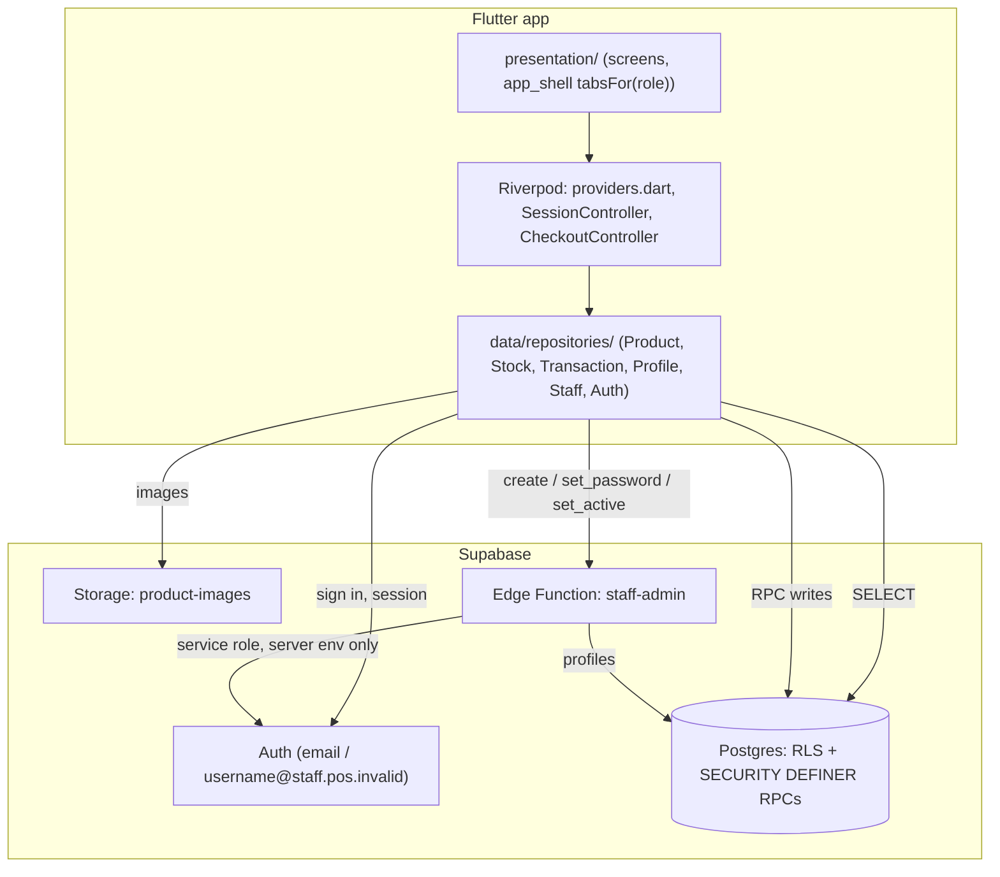
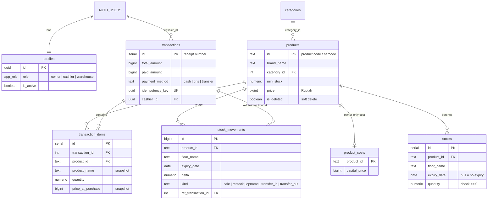
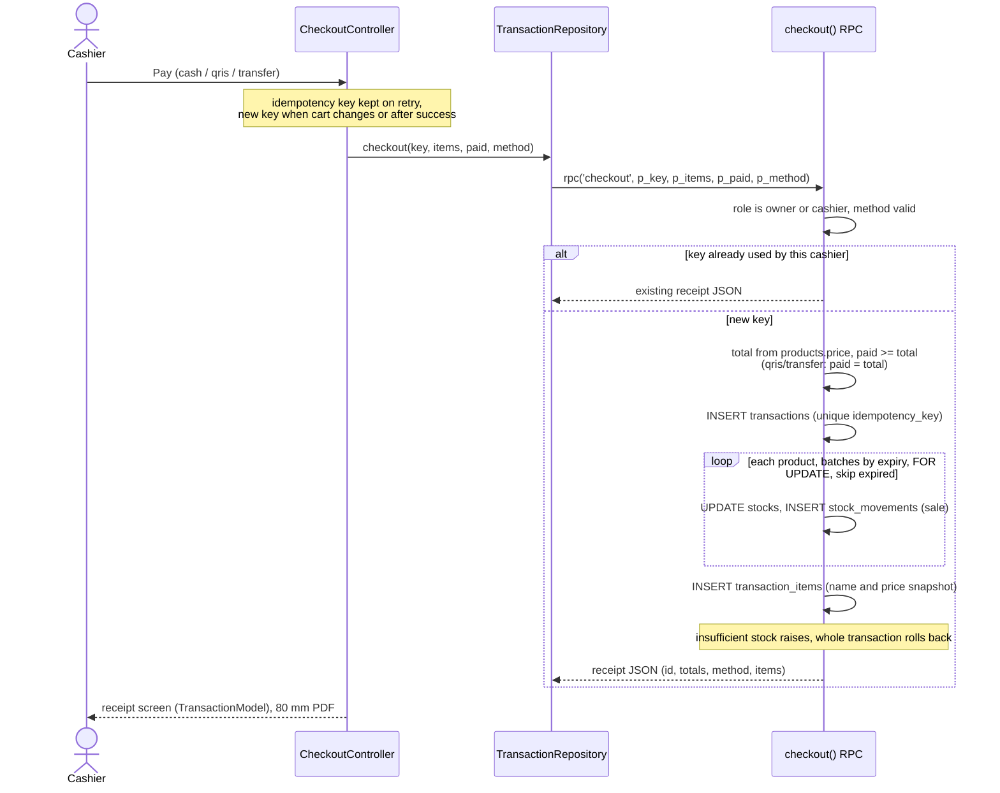

# Architecture

Schema after migrations 0001–0005 in [`supabase/migrations/`](../supabase/migrations), plus
[`supabase/functions/staff-admin`](../supabase/functions/staff-admin).

## System

All Supabase calls live in `lib/data/repositories/`. The client key must be publishable;
`core/supabase_key_guard.dart` rejects `sb_secret_` keys and `service_role` JWTs at startup.

## Data model

Constraints worth knowing: `stocks` is unique on `(product_id, floor_name, coalesce(expiry_date, 'infinity'))`,
so one row is one batch. `authenticated` has no `INSERT/UPDATE/DELETE` on `stocks`, `transactions`,
`transaction_items` or `stock_movements`, and no `DELETE` on `products`.

## Checkout sequence

## Role matrix

`lib/core/permissions.dart` (`can(role, Permission)`) mirrors this in the UI but only hides menus.
| Resource | Owner | Cashier | Warehouse | Enforced by |
|---|---|---|---|---|
| `profiles` | read all, update | read self | read self | RLS; trigger blocks changing own role/status |
| `categories` | read, write, delete | read | read, insert, update | RLS |
| `products` | read, insert, update | read | read, insert, update | RLS; trigger: price and `is_deleted` owner-only |
| `product_costs` | all | — | — | RLS |
| `stocks` | read | read | read | RLS; writes via RPC |
| `restock`, `stock_count`, `transfer_stock` | ✅ | — | ✅ | role check inside RPC |
| `create_product_with_stock` | ✅ | — | ✅ (price 0) | role check inside RPC |
| `checkout` | ✅ | ✅ | — | role check inside RPC |
| `transactions`, `transaction_items` | read all | read own | — | RLS |
| `stock_movements` | read | — | read | RLS; writes via RPC |
| Storage `product-images` | read, upload, delete | read | read, upload | storage policies (0003) |
| `staff-admin` | ✅ | — | — | function checks caller is an active owner |
